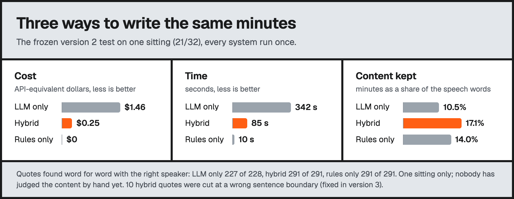
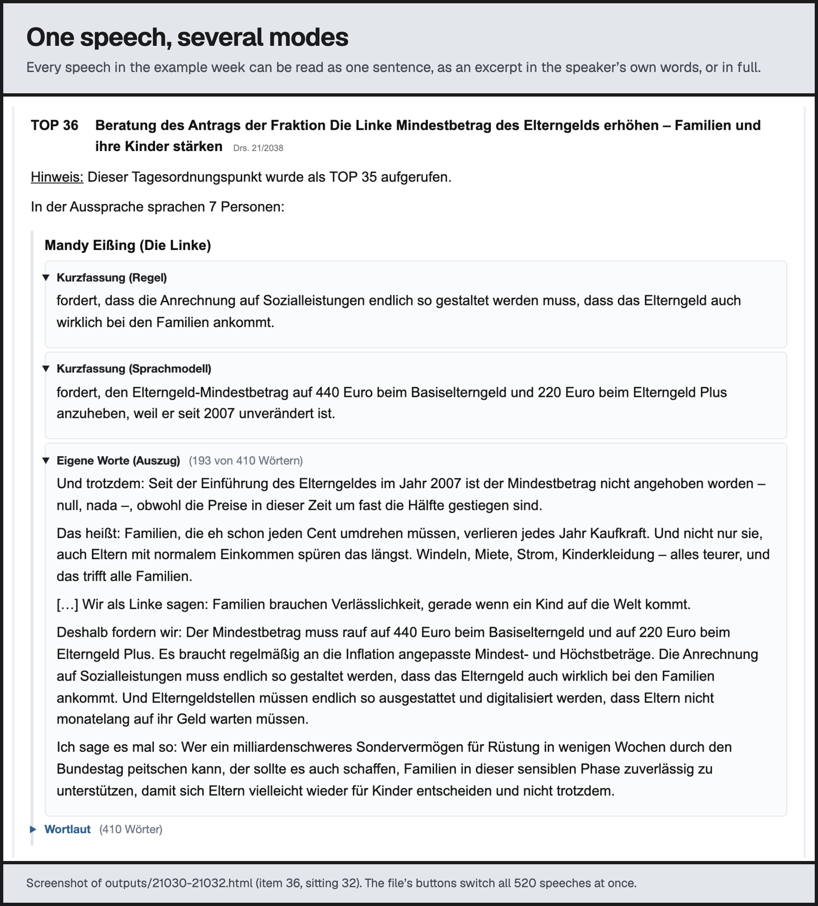
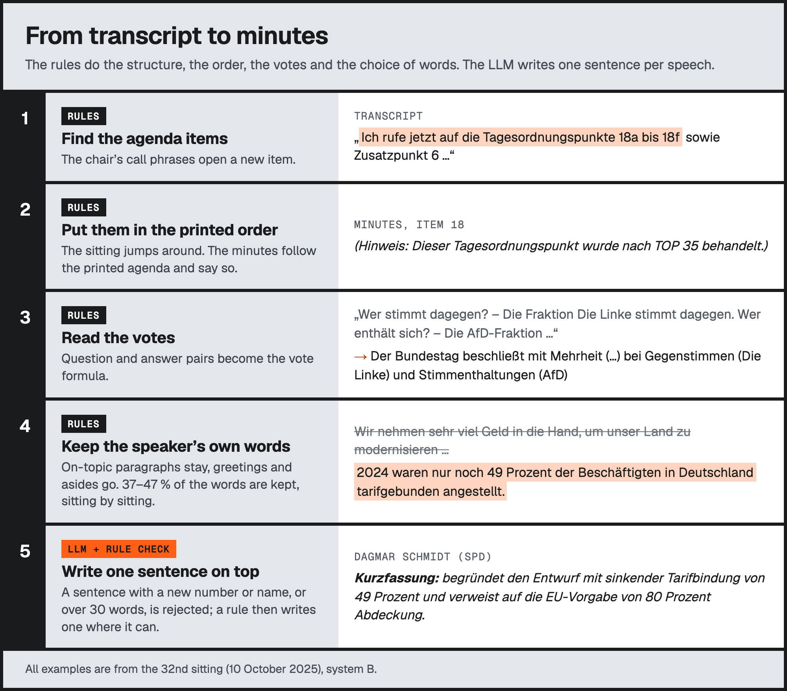
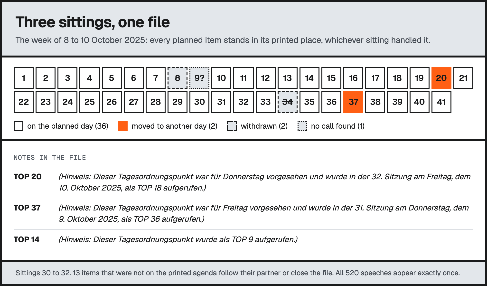

# Bundestag Minutes Generator


This tool writes narrative minutes (*Niederschrift*) of German Bundestag sittings from the public verbatim record
(*Plenarprotokoll*). Computational-linguistic rules do most of the work, and a language model (LLM) writes only one short
sentence per speech. The minutes:

- **follow the printed agenda** (*Tagesordnung*), even when items were taken in a different order. All sittings of a week
  can be joined into **one file, from TOP 1 to the last planned item**;
- **keep the speakers' own words.** Each speech opens with a one-sentence summary (*Kurzfassung*), followed by up to half
  of the speech in its exact wording, with omissions marked […];
- **take votes and decisions from the official record**, not from a model.

*Glossary:* TOP = agenda item (*Tagesordnungspunkt*) · Zusatzpunkt (ZP) = item added after printing · Drucksache = numbered
parliamentary paper · Fragestunde = question time · Amtliches Protokoll = the Bundestag's record of decisions · 21032 = sitting
32 of the 21st Bundestag.

## Key results

From the frozen version 2 test on one unseen sitting (21032), comparing the same minutes written by a model alone, by this
hybrid and by rules alone:

- **A sixth of the cost:** $0.25 for the hybrid against $1.46 for the model alone, and 85 against 342 seconds.
- **Every quote found word for word with the right speaker:** 291 of 291 (model alone: 227 of 228).
- **More words kept:** 17% of the speech words against 10.5%. Nobody has judged the content by hand yet.



The current version (3.1) keeps 37–47% of the words. All tables, the later versions and what went wrong:
**[docs/RESULTS.md](docs/RESULTS.md)**.

## Example: one week, several modes

The example output is one whole sitting week (sittings 30 to 32, 8 to 10 October 2025) in one file. Every speech can be read in
several modes, one by one or for the whole file:

| Mode | What it is | Speeches |
|---|---|--:|
| Kurzfassung (Regel) | one sentence, formed by rules | 204 |
| Kurzfassung (Sprachmodell) | one sentence, written by the LLM and checked by rules (sitting 32) | 75 |
| Eigene Worte (Auszug) | the chosen paragraphs in the speaker's words | 507 |
| Wortlaut | the full speech, the excerpt highlighted | 520 |



**Open it:** [as PDF](outputs/21030-21032.pdf) (the excerpt mode), or download
[the interactive file](https://github.com/Panoserms/bundestag-minutes-generator/raw/main/outputs/21030-21032.html) and open it in a browser.

## How it works



1. **Segmentation.** The chair's call phrases and paper numbers show which agenda item is being discussed.
2. **Order.** The items go back into the order of the printed agenda, with a note where the sitting differed.
3. **Votes.** The chair's questions and the answers give who voted how; decision texts are copied from the Amtliches
   Protokoll.
4. **Own words.** A statistical topic signature shows what belongs to the item. Every sentence is scored, and the best
   on-topic paragraphs are kept.
5. **Summary.** The LLM writes one sentence, which rules check for new numbers, new names and length. In the rules-only
   version, a rule writes it.

Every rule with its linguistic basis is in the **[rulebook](docs/RULES.md)**.

### A whole week in one file

A sitting week usually has three sittings and one printed agenda, and items move between days. The week mode looks for every
planned item in all sittings of the week and puts it back in its printed place:



### Side study

A study of a county council's public agendas (*Tagesordnungen*) and decision records (*Beschlussprotokolle*) tests which
rules carry over to local government: [findings](konstanz_agenda_study/FINDINGS.md).

## Limits

- The comparison with the model alone rests on **one sitting**, in version 2. Version 3.1 has no clean held-out number yet.
- Nobody has judged content or readability by hand, and the metrics come from the author of the systems.
- The minutes are drafts: some items carry a *Prüfhinweis* where the chair's result and the official record do not match.
- The week mode was built on the week of sittings 98 to 100. The example week was only checked for order and completeness, and
  its sitting 31 is part of the background statistics.
- In question time, questions the chair read out appear in the chair's words.

## Run it

```bash
python3.11 -m venv .venv && .venv/bin/pip install -r requirements.txt
.venv/bin/pip install https://github.com/explosion/spacy-models/releases/download/de_core_news_md-3.8.0/de_core_news_md-3.8.0-py3-none-any.whl
.venv/bin/python -m niederschrift.compose 21032 --system C                # one sitting, rules only, about 10 s
.venv/bin/python -m niederschrift.compose 21032 --system B                # hybrid, from the saved LLM replies
.venv/bin/python -m niederschrift.week 21030 21031 21032 --llm            # the example week, about 1 min
.venv/bin/python scripts/evaluate.py 21032                                # the metrics
.venv/bin/python -m pytest -q                                             # tests
```

`--pdf` also writes a PDF (Microsoft Edge on macOS). New LLM calls need `NIEDERSCHRIFT_LLM_CMD`; see `niederschrift/llm.py`.

## Repository

| Path | What |
|---|---|
| `niederschrift/` | the pipeline: segmentation, order, votes, topic, excerpts, summary, week, rendering |
| `baseline/` | the model-only system and its parser |
| `scripts/` | evaluation, side-by-side view, background statistics |
| `docs/` | [results](docs/RESULTS.md), [rulebook](docs/RULES.md), [architecture](docs/ARCHITECTURE.md), style guides (current, and the one used in the scored test) |
| `data/` | the public input documents, their URLs, word statistics |
| `outputs/` | the example week (HTML, PDF, JSON); new runs are written here |
| `results/` | scores, and the runs behind them (`nds/`, `v2_frozen/` is the scored test) |
| `konstanz_agenda_study/` | the side study |

## Data and licence

All inputs are public documents of the Deutscher Bundestag (bundestag.de open data; official works under § 5 UrhG).
The printed Tagesordnung PDFs were recovered from Wayback Machine snapshots. The background statistics come from 58
other public Plenarprotokolle (`data/background_sittings.txt`). The Münster resources are word statistics derived
from the public Niederschriften of the Stadt Münster (OParl), without any text from them. The side study uses the
public agendas and decision records of the Kreistag Konstanz; only statistics are committed, and `fetch.py`
downloads the documents.

The code is under the MIT licence. The documents in `data/raw/` are official works and are not covered by it.
