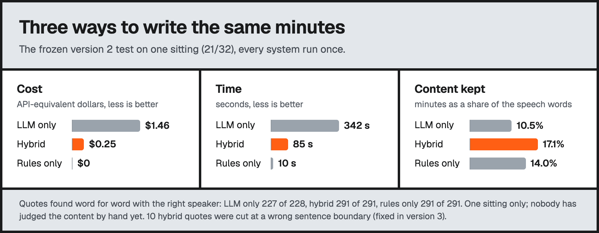
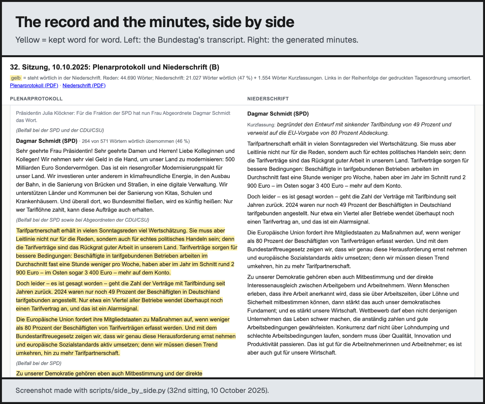

# Results

All numbers come from `scripts/evaluate.py` and the logs in `results/`. Rules were built and tuned on the development
sittings 21055, 21098, 21099 and 21100; 21030, 21032 and 21085 are test sittings. "21032" is the 32nd sitting of the 21st
Bundestag.

**The three systems.** **A** = a language model writes everything in one call. **B** (hybrid) = rules, plus one
model-written sentence per speech. **C** = rules only.

**Versions.** Version 2 is the scored comparison: it quoted about 12% of each speech and added one sentence of reported
speech. Version 3 keeps about half of each speech word for word and puts a one-sentence summary (*Kurzfassung*) on top.
Version 3.1 (current) adds two segmentation rules. The week merge was added after that.

## The scored comparison (version 2, frozen)

Three systems get the same inputs: the transcript without agenda markup, the printed Tagesordnung, the Amtliches
Protokoll and the same [style guide](style_guide_scored.md), the version that was current at the time of the test.
- **A** (LLM only) writes everything in one call.
- **B** (hybrid) uses the rules above, plus the LLM for the reported sentence.
- **C** (rules only) uses a template instead of the LLM.

The LLM is one large hosted model, called through a command-line client (the same model for A and B). The style guide was changed afterwards for version 3 ([`style_guide.md`](style_guide.md)).

The rules were built and tuned on the dev sittings 21055, 21098, 21099 and 21100. The test sitting **21032**
(10 Oct 2025) was run **once** with frozen systems.

| 21032, test | A: LLM only | B: hybrid | C: rules only | old v1 hybrid |
|---|---|---|---|---|
| Quote segments verbatim from the attributed speaker | 227 / 228 (99.6%) | **291 / 291 (100%)** | 291 / 291 | – (1% of words quoted) |
| Quotes attributed to the wrong speaker | 0 | 0 | 0 | – |
| Quotes filed under the right agenda item (XML gold) | 227 / 227 | 291 / 291 | 291 / 291 | – |
| Printed agenda items out of printed order | 0 | 0 | 0 | 0 |
| Quotes cut at a wrong sentence boundary | 0 | 10 | 10 | – |
| Debate text, % of speech words | 10.5% | 17.1% | 14.0% | 6.8% |
| Share of debate text in direct quotes | 75% | 68% | 83% | 1% |
| Most frequent intro verb (share of speeches) | *kritisierte/erklärte* 22% | *erklärte* 52% → **12%** in v2.1¹ | same as B | *führte aus* 55% |
| Different intro verbs | 19 | 10 → **16**¹ | same as B | 5 |
| LLM calls | 1 | 8 | 0 | 15 |
| Input / output tokens | 203,450 / 64,946 | **40,128 / 8,742** | 0 | – |
| Cost (API-equivalent) | $1.46 | **$0.25** | $0 | – |
| Wall time | 342 s | 85 s (calls in sequence) | **10 s** | – |

¹ The test run showed that the frozen frame rules still overused *erklärte*: they only avoided repeating the
previous verb. Version 2.1 picks the least-used verb of the class instead. It was checked only on dev (21100: top
verb 14%, 21055: 17%). The 12% on 21032 is shown for information; it is not a clean test number.

Rules only (C) on the two other test sittings, both Wednesdays with government question time and Fragestunde:

| | 21030 | 21085 |
|---|---|---|
| Quote segments verbatim from the attributed speaker | 320 / 325 | 277 / 280 |
| Quotes filed under the right item | 277 / 320² | 277 / 277 |
| Printed items out of order | 0 | 0 |
| Debate text, % of speech words | 18.3% | 17.4% |

² The 43 misfiled quotes are the Fragestunde problem fixed in v3.1.

Segmentation on dev (unit accuracy against the XML agenda blocks): 100% on 21055, 21098 and 21100; 99.3% strict
on 21099.

### Reading the numbers
- **Cheaper and faster: yes.** On 21032 the hybrid used 17% of the LLM-only cost and 20% of its input tokens. The
  LLM sees only the off-topic sentences, never the whole 47,000-word record. The rules-only system costs nothing
  and runs in 10 seconds of CPU time (spaCy included).
- **As accurate on what was measured.** The LLM-only system quoted very faithfully here (one quote not found). The
  hybrid copies only from the record, and every quote was found with its speaker in this test. Both kept the printed order and filed every quote under the right item.
- **Keeps more words:**
  - The hybrid keeps more of each speech: 17% of the words vs. 10.5%.
  - It covers 81 speeches; A covers 83, because it also reports some chair turns.
  - Whether the right content was kept has not been judged by a human yet.
- **Where the rules are weaker:**
  - 10 quotes start or end at a wrong sentence boundary (spaCy sentence splits around dashes and colons).
  - On a Wednesday with question time, 43 quotes were filed under the wrong item, because the chair called the
    Fragestunde with an unusual verb (fixed in v3.1 by rule S2b).
  - The LLM's reported sentences fail the rule check in 22 of 81 cases. 13 of them were replaced by the template,
    and 9 got no reported sentence.
  - One reported sentence passed the check but contains an evaluative word ("sarkastisch") that the style guide
    forbids.

## Version 3: how much of each speech is kept

The rules (excerpt, order, votes) are the same in B and C. Only the Kurzfassung differs: the LLM writes it in B,
and a rule writes it in C.

| | dev 21055 | dev 21098 | dev 21099 | dev 21100 | 21032 (B) |
|---|---|---|---|---|---|
| Words of the speeches kept word for word | 42.7% | 43.0% | 47.2% | 46.9% | 47.0% |
| Excerpt segments found verbatim with the attributed speaker | 309/315¹ | 347/353¹ | 642/642 | 300/300 | 258/258 |
| Sentences cut at a wrong boundary | 0 | 0 | 0 | 0 | 0 (v2: 10) |
| Omission marks […] per speech | 0.55 | 0.56 | 1.94 | 2.04 | 2.21 |
| Speeches with a Kurzfassung (C rule) | 47/209 | 53/234 | 126/220 | 47/102 | 42/81 |

¹ The others are written questions that the chair read out in question time. They are credited to the person who
asked, so they appear in the chair's words, not the asker's.

On 21032 the hybrid writes a Kurzfassung for 77 of 81 speeches:
- 75 come from the LLM and passed the rule check;
- 2 come from the rule, after the LLM's sentence failed the check;
- 4 speeches have none.

Of the 6 LLM sentences that failed the check:
- 4 contain a compound noun that is not in the source (e.g. *Sanktionsbefugnis*);
- 1 has a year that is not in the source (*1989*);
- 1 uses quotation marks.

The Kurzfassungen open with 22 different verbs; the most frequent (*lehnt … ab*) opens 17% of them.

Cost of B on 21032: 8 LLM calls, 75,329 input / 6,404 output tokens, $0.37 (v2: $0.25; A: $1.46). The LLM now reads
more of each speech, because it summarises the whole speech instead of only the off-topic part. That is still 37%
of A's input. Rules alone: 10–25 s CPU per sitting.

The v3 changes were made after looking at the 21032 output, so the 21032 column is **not** a clean test number. The
parameters (50% budget, paragraph units, adjacency bonus 0.4, gap fill ≤ 25 words) were set on the four dev sittings.
C on the two untouched test sittings (run once): 21030: 43.7% kept, 321/326 verbatim; 21085: 37.0% kept, 295/300
verbatim. The rest are again read-out questions, plus one not found.

## Version 3.1: two segmentation rules from the 21030 output

Reading the 21030 output showed two errors, both at the start of the sitting:
- the chair opened the Fragestunde with "… und steigen jetzt ein in Tagesordnungspunkt 2:". No call cue covered
  this verb, so all 52 Fragestunde speeches stayed under TOP 1 (Befragung der Bundesregierung);
- the announcement "Tagesordnungspunkt 8, Tagesordnungspunkt 30b und Tagesordnungspunkt 39x werden abgesetzt." was
  read as a call, because it opens with an item number. The minutes then claimed that TOP 8, 30 and 39 were
  "jointly debated", and TOP 1 got the note "behandelt nach TOP 39".

Two general rules fix them: **S2b**, the colon at the end of a chair turn points forward to the item it names;
**S6b**, items in a sentence whose predicate withdraws them (*abgesetzt, vertagt*) are not called.

| | before (v3) | after (v3.1) |
|---|---|---|
| 21030: units on the right item (XML gold) | 88.6% | **100%** |
| 21030: excerpts filed under the right item | 263 / 315 | **319 / 319** |
| 21030: speeches under TOP 1 / TOP 2 (Fragestunde) | 178 / 0 | 126 / 52 |
| 21032, 21085 | unchanged | unchanged |
| Dev sittings 21055, 21098, 21099, 21100 (all metrics) | – | unchanged |

Both rules were found by looking at 21030, so **21030 no longer counts as a held-out sitting**. A new held-out
sitting is needed to measure v3.1. Regression tests: `tests/test_segment_rules.py`.

## A whole sitting week

`niederschrift/week.py` joins all sittings of a week into one file in the order of the printed weekly agenda (rules W1–W6
in [`RULES.md`](RULES.md)). On the development week (sittings 98 to 100, 7 to 9 October 2026, rules only):

| | |
|---|---|
| Planned items in the file, in printed order | 38 of 38 |
| Planned items handled on another day than planned | 6 |
| Planned items handled together with another planned item | 2 |
| Planned items withdrawn / no call found | 3 / 1 |
| Items that were not on the printed agenda | 20 |
| Speeches in the three sittings / in the week file | 556 / 556, each once |
| Votes and decisions | 44 / 44 |
| Time (rules only, CPU) | about 45 s |

The example week in `outputs/` (sittings 30 to 32, 8 to 10 October 2025) was only checked for order and completeness: 41 of 41
planned items in order, 2 of them moved to another day, 2 withdrawn, 1 without a call, 13 items that were not printed, and 520 of
520 speeches once. Sitting 31 is part of the background statistics, so its excerpts are not a clean test.

## Limits
- A was run on one test sitting only, so the A–B comparison rests on one sitting, and with the v2
  style. A v3 comparison needs A re-run with the v3 rules on a fresh sitting.
- Nobody has judged content coverage or readability by hand yet.
- The week merge was built on the week of sittings 98 to 100. A second week (30 to 32) was only checked for order and
  completeness, not scored.
- The quote/report sentence labels were tuned by inspection on dev, not on a hand-labelled set.
- The metrics were written by the same author as the systems.
